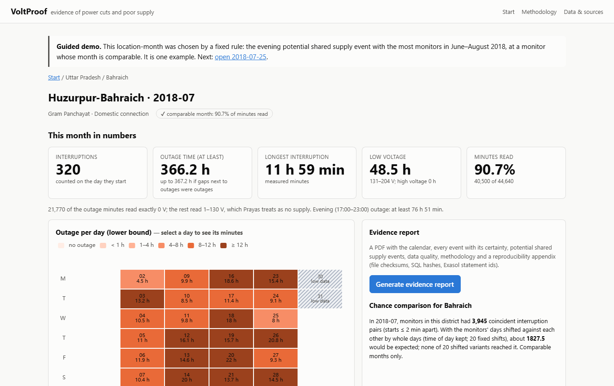
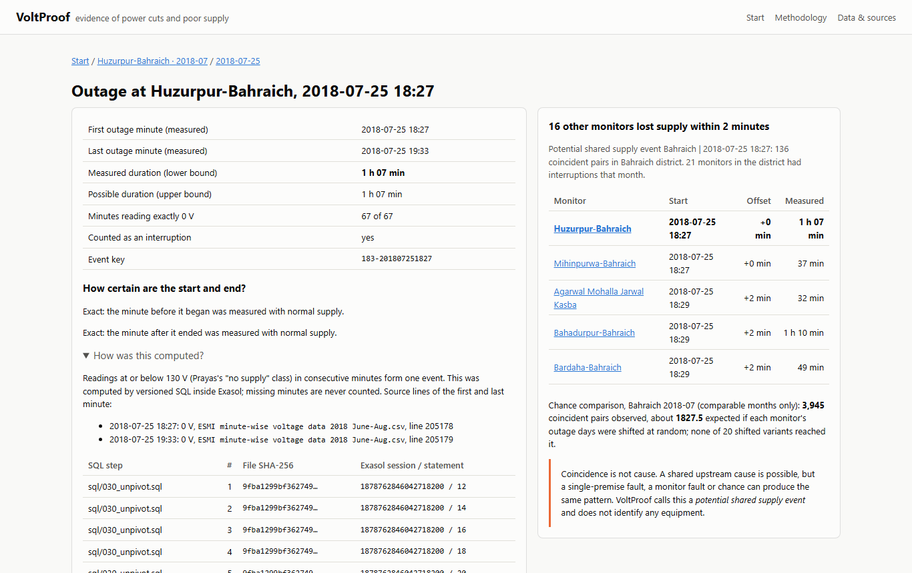
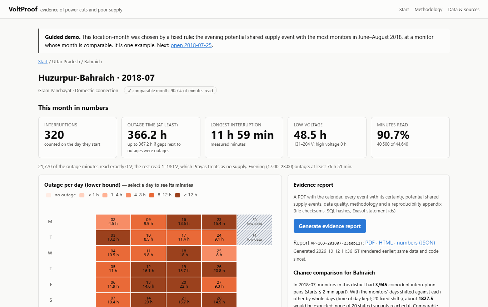

Households and small shops on unreliable electricity can't show when, and for how long, their power failed, because when they complain, their own memory is usually all they have to set against the utility's records. If this worked, they could take a dated, minute-by-minute record of every outage and voltage problem, with its uncertainty stated, to their utility or grievance forum.

# VoltProof

[](https://github.com/stredevirad/voltproof-exathon-2026/actions/workflows/ci.yml)

**Traceable evidence of power cuts and poor supply, from minute-by-minute voltage records, analysed inside Exasol.**

ExaThon India 2026, Track 3. Data: Prayas (Energy Group), Electricity Supply Monitoring Initiative (ESMI).
Team: Joshua Herbert Japheth, Rohith Mohandas, Dane John Padinjarekara — Rajagiri School of Engineering &
Technology, Kochi.
This project was built with AI coding assistance (Claude Code).

## For judges: start here

> **VoltProof turns public minute-by-minute voltage records into a dated, checkable record of every power cut, with
> its uncertainty stated.**
>
> **Watch first:** the [demo video](docs/deliverables/VoltProof_demo.mp4) (2:14) and the
> [pitch deck (PDF)](docs/deliverables/VoltProof_deck.pdf).
>
> **What Exasol does here** ([WHY_EXASOL](docs/WHY_EXASOL.md), [BENCHMARKS](docs/BENCHMARKS.md)):
> - All analysis is versioned SQL inside Exasol Personal, over 102.8 million clean minute readings; the full Uttar
>   Pradesh build takes 210.4 s on a 15.6 GB laptop.
> - Finding every power cut went from 665 s to 35.6 s by rewriting the step as one `ROW_NUMBER` window.
> - Every SQL statement is matched against Exasol's own audit log (`EXA_DBA_AUDIT_SQL`): 0 different, 0 missing.
>
> **Why you can trust the numbers:** 208 automated tests, including an independent Python oracle that must equal the
> SQL exactly ([TEST_REPORT](docs/TEST_REPORT.md), [VALIDATION](docs/VALIDATION.md)).
>
> **Try it** (no data download; Windows 10/11, about 16 GB RAM): the
> [Quick start](#quick-start-windows-1011-amd64-no-data-download), with about 3 minutes of setup, about 2 minutes for a
> first-time database install, and the demo data built in seconds.
>
> | One month (at least 366.2 h of outage) | One outage's evidence | The evidence report |
> |---|---|---|
> | <a href="docs/deliverables/screenshots/02_month_calendar.png"></a> | <a href="docs/deliverables/screenshots/04_event_evidence.png"></a> | <a href="docs/deliverables/screenshots/05_report_ready.png"></a> |

## Submission deliverables

| Deliverable | Where |
|---|---|
| Problem statement | [docs/deliverables/PROBLEM_STATEMENT.md](docs/deliverables/PROBLEM_STATEMENT.md) (the one-sentence statement is also the first line of this README); how VoltProof approaches it: [APPROACH.md](docs/deliverables/APPROACH.md) |
| Pitch deck (PDF) | [docs/deliverables/VoltProof_deck.pdf](docs/deliverables/VoltProof_deck.pdf). The source is `docs/deliverables/deck/deck.html`, rendered and checked by `python -m pipeline.deck` |
| Demo video (narrated, under 3:00) | [docs/deliverables/VoltProof_demo.mp4](docs/deliverables/VoltProof_demo.mp4) (2:14, subtitles burned in), recorded live by the team; see [About the video](#about-the-video) below. Demo notes: [DEMO_SCRIPT.md](docs/DEMO_SCRIPT.md) |
| Run guide | [Quick start](#quick-start-windows-1011-amd64-no-data-download) below (no download needed), [Real data](#real-data-esmi-harvard-dataverse), and [docs/SETUP_WINDOWS.md](docs/SETUP_WINDOWS.md); manual steps for [macOS / Linux](#macos--linux-not-tested-by-the-team), not tested by the team |
| Licence | MIT, [LICENSE](LICENSE); third-party notices in [THIRD_PARTY_NOTICES.md](THIRD_PARTY_NOTICES.md) |
| Live demo runbook | [docs/deliverables/LIVE_DEMO_RUNBOOK.md](docs/deliverables/LIVE_DEMO_RUNBOOK.md) |
| Evidence behind the claims | [VALIDATION](docs/VALIDATION.md), [BENCHMARKS](docs/BENCHMARKS.md), [TEST_REPORT](docs/TEST_REPORT.md), [JUDGE_QA](docs/JUDGE_QA.md), [METHODOLOGY](docs/METHODOLOGY.md), [DECISIONS](docs/DECISIONS.md) |

### About the video

The team recorded the demo video live, in its own words. Four things in its narration are said loosely; the app and
this README state them precisely:
- **"366.2 hours of outage time"** is a minimum: the app shows **at least 366.2 h** (up to 367.2 h) for one monitor,
  Huzurpur-Bahraich, in July 2018. Missing readings are never counted as outage.
- **"We upload the data as a CSV file … from Harvard":** the guided demo uses the Prayas data already loaded from
  Harvard Dataverse. Uploading your own file is a separate feature ([Use your own data](#use-your-own-data)).
- **"KSEB … exactly where the outage errors were and exactly how to solve it":** the data is from Uttar Pradesh, not
  Kerala; KSEB was named only as an example of a utility. VoltProof gives a dated record of when and for how long
  supply failed. It names no cause and no fix.
- **The shopkeeper** is an **Illustrative** example, not a person in the data.

The earlier written script is [VOICEOVER_SCRIPT.md](docs/deliverables/VOICEOVER_SCRIPT.md).

## The problem

In much of India, households and small shops still live with daily power cuts and voltage that is too low
or too high to use. When they complain, their memory is the only record they have, set against the
utility's own reports. Prayas (Energy Group) ran independent plug-in voltage monitors (ESMI) at hundreds of
homes and shops and published the minute-by-minute readings. Those readings are raw: 63-column hourly
rows, gaps, duplicates and file defects. On their own they don't add up to evidence a consumer can show anyone.

## What VoltProof does

VoltProof turns the raw ESMI files into evidence you can check, one location-month at a time. The whole
analysis is versioned SQL that runs **inside Exasol**.

- **Every outage.** Each interruption gets exact timestamps, a certainty for each edge (exact, bounded or
  censored) and a lower and upper duration. The headline is always the lower bound.
- **Missing data stays missing.** A minute without a reading is never counted as an outage.
- **Daily and monthly figures.** These are computed on a full calendar, with coverage. A month counts as
  comparable only if more than 90% of its minutes were read (Prayas's rule).
- **Potential shared supply events.** These are interruptions at different monitors in a district that
  start within 2 minutes of each other. Each district-month is compared with a time-shifted chance baseline.
- **An evidence report (PDF).** It traces every number to the source file and line, the SQL statement's
  hash and its Exasol statement id, and it points to the statutory grievance route.
- **A web app.** A guided demo walks through one real case, from calendar to minute trace to event evidence
  to report. A "How to use" page explains every colour and number in plain words, and a short optional tour
  shows a first-time visitor where things are.
- **Your own data.** Readings from your own monitor can be uploaded on this computer and analysed by the same
  SQL, in their own schema, always labelled "Uploaded data — not verified by VoltProof"
  ([Use your own data](#use-your-own-data)).

| | Status |
|---|---|
| Minute classification (Prayas thresholds), events with certainty and bounds, daily/monthly aggregates, coverage, quarantine | **Implemented and tested** (hand-written fixtures, independent oracle, Hypothesis, real data) |
| Coincidence across monitors with a chance baseline | **Implemented and tested** |
| Evidence report with provenance; web app; guided demo | **Implemented and tested** (report consistency tests, Playwright end-to-end) |
| Uploading your own readings (ESMI layout, Dataverse `.tab`, one reading per line) | **Implemented and tested** (an uploaded file gives the same results as the command-line build of the same file) |
| Beginner's guide, first-visit tour; readable in dark mode and on a phone; WCAG AA text contrast | **Implemented and tested** (Playwright, contrast measured on every screen) |
| Comparison with Prayas's published figures | **Done**, with an honest result: see [Validation](#validation-against-prayas) |
| Live monitors or smart-meter feeds; state-specific standards of performance; other states | **Future scope**, not claimed |

**What VoltProof does not claim:**
- It does not state what a consumer is owed, or that any rule was breached.
- It does not identify a cause or a piece of equipment. A potential shared supply event is a coincidence
  in time, not proof of a common cause.
- It does not describe today's supply. ESMI data is historical (2014–2019).
- A plug-in monitor is not the utility's meter.

The report says this in plain words and is not legal advice.

## Quick start (Windows 10/11, AMD64): no data download

You need Git, [uv](https://docs.astral.sh/uv/), Node.js 20 or newer, WSL 2 and about 16 GB RAM. Keep
Docker Desktop closed while the database runs. Full details and troubleshooting are in
[docs/SETUP_WINDOWS.md](docs/SETUP_WINDOWS.md).

```powershell
git clone https://github.com/stredevirad/voltproof-exathon-2026.git D:\Projects\VoltProof
cd D:\Projects\VoltProof
Set-ExecutionPolicy -Scope Process Bypass        # this terminal only; repeat it in every new terminal
scripts\bootstrap.ps1                            # about 3 minutes: Python 3.12, dependencies, Exasol launcher, Chromium, web build (all inside the repo)
```

**1. Exasol Personal.** Check whether a database is already running:

```powershell
scripts\exa.ps1 status
```

- If it prints `database_ready`, go to step 2.
- If it prints `database_connection_failed`, the database may still be starting or busy: wait a moment and
  run `status` again.
- After a Windows restart, run `scripts\exa.ps1 start`.
- First time on this machine:

  ```powershell
  winget install -e --id RedHat.Podman             # then open a new terminal and repeat Set-ExecutionPolicy above
  scripts\exa.ps1 install local --auto-approve     # about 2 minutes; accepts the Exasol Personal EULA
  ```

**2. Build the SYNTHETIC demo set.** This needs no download and takes seconds.

```powershell
scripts\load.ps1 -Set demo
```

- `pipeline/synthetic.py` writes 20 invented monitors in the ESMI file format (one month, about 4 MB, the
  same every time). They are built into their own schema, `VOLTPROOF_DEMO`, by the same SQL that analyses
  the real data.
- Every name carries "SYNTHETIC", and the app and reports show a **SYNTHETIC DEMO DATA** banner. No figure in
  this build describes real supply, and synthetic and real data never share a schema
  ([DECISIONS D-033](docs/DECISIONS.md)).

**3. Open the app** at http://127.0.0.1:8000/ and press **Start guided demo**:

```powershell
scripts\start.ps1                # stop it with Ctrl+C; stop it before rebuilding with load.ps1
```

**What you should see:** a SYNTHETIC DEMO DATA banner on every page; **Start guided demo** opens an invented
monitor in January 2030; its day (17 January) and the outage's evidence page, where 8 other monitors lost supply
within 2 minutes.

On a first visit a short, skippable tour shows where things are (four or five steps, depending on how many
datasets are on the computer). **How to use** in the menu explains every colour and number; its button **Show the
short tour of the start page** starts the tour again.

**4. Run the tests** (unit, integration, differential, end-to-end):

```powershell
scripts\test.ps1
```

The tests that need the real files skip cleanly on a demo-only machine. The synthetic set is also checked
against the independent oracle in full.

GitHub Actions ([ci.yml](.github/workflows/ci.yml)) runs ruff and the unit tests on every push and pull
request. The integration, differential and end-to-end suites are not in CI: they need a running Exasol
Personal database (Podman/WSL 2 and about 9 GB of RAM for the database), which hosted runners don't
provide. They run locally with `scripts\test.ps1`, and [docs/TEST_REPORT.md](docs/TEST_REPORT.md) records
the latest full run. How to contribute: [CONTRIBUTING.md](CONTRIBUTING.md).

## macOS / Linux (not tested by the team)

The scripts in `scripts\` are PowerShell scripts for Windows, and we have only run VoltProof on Windows 10/11.
The steps below are the same commands the scripts run, written out by hand for macOS and Linux. **The team has
not tested them.** You need Git, [uv](https://docs.astral.sh/uv/), Node.js 20 or newer and about 16 GB RAM.

**1. Exasol Personal.** Download the launcher for your system from the
[v2.3.0 release](https://github.com/exasol/exasol-personal/releases/tag/v2.3.0) (Linux and macOS builds are
published there; check the file against `exasol-personal_2.3.0_checksums.txt`) and follow the launcher's own
instructions for a local deployment. Always pass `--deployment-dir`: VoltProof reads the connection details
(`deployment.json`, `secrets.json`) from the folder named by `EXASOL_DEPLOYMENT_DIR`.

```bash
export EXASOL_DEPLOYMENT_DIR="$HOME/ExasolDeployments/voltproof"
./exasol install local --deployment-dir "$EXASOL_DEPLOYMENT_DIR" --auto-approve   # accepts the Exasol Personal EULA
./exasol status --deployment-dir "$EXASOL_DEPLOYMENT_DIR"                          # wait for database_ready
```

**2. Python, the PDF browser and the web app.**

```bash
git clone https://github.com/stredevirad/voltproof-exathon-2026.git voltproof && cd voltproof
uv sync --frozen --python 3.12
uv run --frozen playwright install chromium
(cd app/web && npm ci && npm run build)
```

**3. Build the SYNTHETIC demo set** (no download) and check its provenance:

```bash
uv run --frozen python -m pipeline.build --schema VOLTPROOF_DEMO --demo
uv run --frozen python -m pipeline.check_provenance VOLTPROOF_DEMO
```

**4. Open the app** at http://127.0.0.1:8000/:

```bash
VOLTPROOF_SCHEMA=VOLTPROOF_DEMO uv run --frozen uvicorn app.api.main:app --host 127.0.0.1 --port 8000
```

## Real data (ESMI, Harvard Dataverse)

The real readings are published by Prayas (Energy Group) on Harvard Dataverse. Each file download records a
short Guestbook response, so you download them under your own name.

**Minimum set (about 141 MB, the 2018 June–August file; enough for the guided demo on real data).**
Choose one of these:

- **Scripted:** copy `.env.example` to `.env` (gitignored), fill in **your own** `DATAVERSE_GB_NAME`,
  `_EMAIL`, `_INSTITUTION`, `_POSITION` and `_INTENDED_USE`, then run the commands below. Downloading and
  verifying took 56 seconds on the build laptop.

  ```powershell
  scripts\get-data.ps1 -Set first -Download      # one Guestbook response per file; checksums verified against Dataverse
  scripts\load.ps1 -Set first                     # builds schema VOLTPROOF (it took 27 s in the clean-start test)
  ```

- **Browser:**
  1. Open https://dataverse.harvard.edu/dataset.xhtml?persistentId=doi:10.7910/DVN/CLLZZM.
  2. Download `ESMI location information`, `About the initiative.pdf` and
     `ESMI minute-wise voltage data 2018 June-Aug` into `data\raw\`, without renaming them. For tabular
     files, choose "Original File Format (Comma Separated Values)".
  3. Run `scripts\load.ps1 -Set first`.

**What you should see on the real data** (measured on the full Uttar Pradesh build): **Start guided demo** opens
Huzurpur-Bahraich, July 2018, with OUTAGE TIME (AT LEAST) at least 366.2 h (up to 367.2 h) and 320 interruptions;
on 25 July the 18:27 outage's evidence page says 16 other monitors lost supply within 2 minutes, and the chance
comparison shows 3,945 coincident pairs observed against about 1827.5 expected.

Once `VOLTPROOF` is built, `start.ps1`, `test.ps1` and `warmup.ps1` use it. To look at the demo set again,
set `$env:VOLTPROOF_SCHEMA = 'VOLTPROOF_DEMO'` first. To build next to an existing build without touching it,
set another schema name the same way. To use another port, run `scripts\start.ps1 -Port 8090`.

**Optional: all of Uttar Pradesh (about 1.9 GB; gives the headline figures below).**
1. Also download 2016 Jan-June, 2016 July-Dec, 2017 Jan-April, 2017 May-Aug, 2017 Sept-Dec, 2018 Jan-May,
   2018 Sep-Dec, 2019 Jan-June and 2019 July-Dec. For the scripted download, use
   `scripts\get-data.ps1 -Set up -Download`.
2. Then run:

   ```powershell
   scripts\load.ps1 -Set up                                  # about 4 minutes on the build laptop
   .venv\Scripts\python.exe -m pipeline.run_sql 110          # validation tables (VALIDATION.md section 3)
   .venv\Scripts\python.exe -m pipeline.headline_figures     # regenerates docs\HEADLINE_FIGURES.md
   ```

   Keep other heavy applications closed: on a 16 GB machine the database uses most of the memory during
   this build.

## Use your own data

Readings from your own voltage monitor can be analysed the same way. Open **Upload your data** in the app (or use
the command line below):

1. Choose the file (and the location file, if you have one) and press **Upload and preview**.
2. Press **Check the file**. If VoltProof asks a question it cannot decide from the data (for example the date
   order), answer it and press **Use my answers and check again**.
3. Press **Analyse this file**, then **Open this dataset**. From then on the **Data** menu at the top (shown when
   there are two or more datasets) lists it as "Your upload: <file name>".
4. To remove it: **Delete this upload**, then **Yes, delete** (before the analysis: **Cancel and delete**).

- **Formats:** the ESMI layout (`Location name, Date, Hour, Min 0 … Min 59`, with an optional location file), the
  Harvard Dataverse `.tab` file, or one reading per line (time and voltage, with an optional monitor column).
  Spreadsheet exports with semicolons or decimal commas work. The upload page links small invented (SYNTHETIC)
  sample files to try it: "readings in the ESMI layout", "its location file" and "one reading per line".
- **What is refused, with the reason:** Excel workbooks (save them as CSV first), values that are not numbers or lie
  outside 0–500 V, files that do not look like a 230 V supply, data that is not one reading per minute, a broken
  hour column, and time zones other than India time (+05:30). Limits: 150 MB per file, 10 uploads, 200 typed-in
  monitor locations, and free disk space of at least 10 GB plus 15 times the file's size (about 12 GB for a 150 MB
  file) on C: and on the drive that holds the database (`ExasolDeployments`); with less, the page says so and the
  analysis does not start. Checking and analysing one 140 MB file took about a minute and a
  half on the build laptop (the full Uttar Pradesh build from the published files is a different measurement:
  210.4 s, see Performance).
- **Same analysis, kept apart:** the file is stored unchanged, checked by SQL (`sql/ingest/`) and analysed by the
  same steps (`sql/020`–`sql/100`) in its own schema `VP_USER_<id>`. That schema belongs to a separate database user
  (`VP_UPLOADER`, created on the first upload; its password is kept in `data/.uploader.json`, gitignored) that has
  no access to the Prayas or SYNTHETIC data.
- **Honest labels:** every page and report says "Uploaded data — not verified by VoltProof", reports get
  `VP-USER-` ids and a mark on every PDF page, and the Prayas attribution never appears on uploaded data.
- **Privacy:** the file stays on this computer (`data/uploads/<id>/`, gitignored) and is never sent anywhere.
  **Delete** on the upload page removes the schema, the file and any reports made from it. Only upload data you
  have the right to use.

```powershell
.venv\Scripts\python.exe -m pipeline.upload new --readings my_readings.csv [--locations my_locations.csv]
#   prints "upload <id> -> schema VP_USER_<ID>; layout ..." (and, for one reading per line, the suggested columns)
.venv\Scripts\python.exe -m pipeline.upload validate <id>    # = "Check the file": the checks, questions and refusals
#   answers to its questions: one reading per line: --long-columns 0,1,2 (positions of monitor, time and voltage,
#   counted from 0; '-' if there is no monitor column) and --long-order YMD|DMY|MDY; ESMI layout: --dash-order or
#   --slash-order DMY|MDY and --hour-base 0|1
.venv\Scripts\python.exe -m pipeline.upload build <id>       # = "Analyse this file": the same SQL steps, its own schema
.venv\Scripts\python.exe -m pipeline.upload list             # or: delete <id>
```

Decisions and evidence: [DECISIONS D-037](docs/DECISIONS.md); tests in `tests/integration/test_uploads.py`,
`tests/differential/test_upload_real.py` and `tests/e2e/test_upload_ui.py`.

## How it works

```
Dataverse CSV ──verify MD5──▶ Exasol IMPORT (raw rows + file id + line no)
   ▶ sql/030  unpivot 63 columns → minutes; parse dates per file; quarantine bad rows
   ▶ sql/040  duplicates and conflicts → clean readings; monitoring window
   ▶ sql/050  voltage classes; runs via one window function (gaps-and-islands); NO_DATA gaps
   ▶ sql/060–090  events with certainty and bounds → daily (full calendar) → monthly (coverage)
   ▶ sql/095  data quality per file and location
   ▶ sql/100  coincident interruptions across monitors; chance baseline (20 whole-day shifts)
   ▶ FastAPI + React app, PDF evidence report (every number traced to file line and Exasol statement id)

Your upload ──staged unchanged (sql/ingest/u10)──▶ checked in SQL (u20) ──▶ standard raw rows (u30)
   ▶ the same steps sql/020–100 in its own schema VP_USER_<id>, under a separate database user
```

The rules are in [docs/METHODOLOGY.md](docs/METHODOLOGY.md), and every choice is recorded in
[docs/DECISIONS.md](docs/DECISIONS.md). Exasol's specific role is in [docs/WHY_EXASOL.md](docs/WHY_EXASOL.md).

## Headline figures (Uttar Pradesh)

From [docs/HEADLINE_FIGURES.md](docs/HEADLINE_FIGURES.md), which a script generates.

- **Scale (full load):** 102,845,781 clean minute readings from 176 monitors (January 2016 to June 2019)
  gave 408,223 outage events, 83,929 location-days and 2,870 location-months.
- **Outage, 2016–2018, comparable months.** Measured minutes only, so these are lower bounds.

  | Category | Monitors | Outage, minutes/day | Interruptions/day | Evening outage (17–23 h), minutes |
  |---|---:|---:|---:|---:|
  | Megacity (Lucknow, Kanpur) | 16 | 56.3 | 1.76 | 11.5 |
  | Other municipal | 68 | 189.5 | 4.03 | 52.1 |
  | Rural | 82 | 566.3 | 7.44 | 152.0 |

- **Potential shared supply events, 2016–2018:**
  - Across the 276 district-months with at least two monitors, interruptions started within 2 minutes of
    each other 91,532 times. The time-shifted baseline expects 40,704.6.
  - 150 of those district-months are above all 20 shifted variants; by pure chance, at most about 1 in 21
    would be (about 13).
  - Coincidence is not cause.

## Validation against Prayas

VoltProof agrees with Prayas's published single-monitor profiles (2017–18, within 0.2 h/day) and its
time-of-day and evening charts. Our daily-outage averages are higher than Prayas's Figure 2. Prayas's
Figure 2 and Figures 8–9 imply different averages, and the article does not state the averaging used for
Figure 2 ([docs/VALIDATION.md](docs/VALIDATION.md) §3).

Correctness is checked independently of that comparison ([docs/VALIDATION.md](docs/VALIDATION.md) §1):
- 18 hand-written fixtures, with expected values derived by hand from the rules;
- an independent plain-Python oracle that must equal the SQL exactly, on the fixtures, on 40 random
  Hypothesis batches and on real Uttar Pradesh slices;
- report-consistency tests;
- every executed statement matched to Exasol's audit log.

Test results are in [docs/TEST_REPORT.md](docs/TEST_REPORT.md).

## Known data defects (found, documented, handled)

- **2019 July–Dec file: the Hour column was lost** (690,915 of 695,974 rows say hour 0). It is loaded and
  verified, then excluded from the analysis (D-026).
- **2019 Jan–June file: most all-0 V hours are omitted.** Prayas's own charts count those hours as no
  supply. VoltProof keeps them as missing data, so outage figures for January–June 2019 are **lower
  bounds**. The app and reports say so, and headline figures use 2016–2018 (D-031, VALIDATION §3.4).
- **2019 files:** dates are M/D/YYYY, where earlier files use DD-MM-YYYY (detected per file, D-025).
  Location names carry an added " [Offline]" (matched only when unambiguous, D-029).

## Performance

Measured on an Intel Core Ultra 5 125H laptop with 15.6 GB RAM ([docs/BENCHMARKS.md](docs/BENCHMARKS.md);
medians of 3 runs). The full Uttar Pradesh build, from IMPORT through every SQL step, takes:
- 210.4 s warm and 238.6 s cold (first run after a database restart);
- of which 30.3 s is the native IMPORT of 7,367,581 raw rows;
- 11.0 s the in-database unpivot to 102,927,720 minute rows;
- 35.6 s run detection over 102.8 million readings with one window function.

These runs had other memory-heavy applications closed. With them open, free host RAM fell below our 0.4 GiB
guard and the run was stopped (both cases are recorded in BENCHMARKS.md).

In the app, warm:
- a location-month opens in about 0.1 s and a day view in about 0.2 s;
- a fresh evidence report (HTML and PDF) takes about 3.7 s, and an unchanged one is served again in 0.4 s.

Right after a database restart, the first day view took 2.1 s; after `scripts\warmup.ps1`, it took 0.13 s.

Every statement in every build matched Exasol's audit log. Why this is Exasol's work and not Python's:
[docs/WHY_EXASOL.md](docs/WHY_EXASOL.md).

## Repository map

| Path | What |
|---|---|
| `sql/` | Numbered SQL steps: the single source of analytical truth; `sql/ingest/` checks and shapes uploads |
| `pipeline/` | Download checks, native IMPORT, step runner with provenance, uploads, benchmarks, validation scripts |
| `app/api`, `app/web` | FastAPI service and evidence report; React + ECharts web app |
| `tests/` | Fixtures, independent oracle, Hypothesis differential, report and end-to-end tests |
| `config/` | Thresholds and parameters (each with its source), declared file periods |
| `docs/` | Methodology, decisions, validation, benchmarks, verification log, judge Q&A, setup |

## Data, citation and licence

- **Data.** Prayas, Energy Group, 2019, "Minute-wise voltage data collected in Electricity Supply
  Monitoring Initiative", https://doi.org/10.7910/DVN/CLLZZM, Harvard Dataverse, V2,
  UNF:6:CQzM5yPH9GilZHSqyRRyEQ== [fileUNF].
  - The dataset is licensed **CC0 1.0** on Dataverse. Prayas also asks for non-commercial, academic and
    research use with acknowledgement, and we follow that.
  - Raw data is **not** redistributed in this repository ([docs/data/SOURCE_TERMS.md](docs/data/SOURCE_TERMS.md)).
- **Code.** MIT licence ([LICENSE](LICENSE)); it covers the VoltProof source code only, not the ESMI data.
  Third-party notices are in
  [THIRD_PARTY_NOTICES.md](THIRD_PARTY_NOTICES.md).
- **Exasol Personal** is used under its End User License Agreement and is not included in this repository.

## Acknowledgements

We are grateful to **Prayas (Energy Group)** and the volunteers of the **Electricity Supply Monitoring
Initiative (ESMI)**, who collected and published these readings. VoltProof exists only because they made
the data public. Any errors in the analysis are ours.
